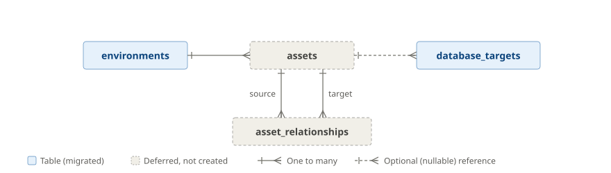

# Data Model

PostgreSQL is Heartbeat's durable system of record for **product metadata**:
inventory, monitored-target metadata, investigation requests and results,
alert and report metadata. It is not a telemetry store.

The schema is defined by the migrations in [`db/migrations`](../../db/migrations)
(`0001_foundations` to `0008_config_approvals`), which are authoritative. If this
page and the migrations disagree, the migrations win; please fix this page.

> **Status:** the schema is migrated and covered by tests. The API (`apps/api`)
> writes `users`, `user_roles` and `audit_outbox` (through
> `api users create-admin`, logins and the users API), the inventory
> (`environments`, `applications`, `application_components`),
> `telemetry_sources`, `database_targets`, `probe_definitions` and
> `probe_assignments`, through `/api/v1`
> ([inventory](../reference/metrics-and-endpoints.md#inventory)) and from the
> environment's inventory file
> ([applying the file](../reference/configuration.md#applying-the-file)). The
> investigation, alerting and reporting tables wait for phase 7. The DB
> collector takes its targets from YAML, not these tables
> ([ADR 0002](decisions/0002-runtime-config-in-yaml.md)).

## What PostgreSQL does not store

See [ADR 0001](decisions/0001-postgresql-metadata-only.md) for the reasoning.

| Data | Where it lives instead |
| --- | --- |
| Raw or derived metrics, live alert evaluation | Prometheus |
| Raw or normalized logs, session evidence | Loki |
| Alert grouping, deduplication, silencing, delivery | Alertmanager |
| Queues, locks, retries, idempotency keys, short-lived caches, login sessions | Redis ([ADR 0013](decisions/0013-api-design-and-subsystem-boundaries.md)) |
| Integration endpoints, Grafana URL templates, credential references, collector desired state | `config/integrations.yaml` / Kubernetes ConfigMaps |
| Audit records | Loki, as OTLP log records; written first to a transient outbox in the change's transaction ([ADR 0016](decisions/0016-audit-records-through-an-outbox.md)) |
| Report binaries | Object storage or filesystem (planned); PostgreSQL keeps only `artifact_uri` |

Tables deliberately **not** created:

| Table | Why not |
| --- | --- |
| `outsystems_sources` | OutSystems is a source type, not a domain object parallel to applications. Its settings live in `telemetry_sources.config`. Promote to a table only if the settings become large, queryable or constraint-heavy. |
| `session_identity_mappings` | Sessions are high-volume, potentially sensitive and telemetry-derived; they are reconstructed from Loki/Prometheus at investigation time. |
| `integration_connections`, `grafana_links` | Deployment-owned YAML and URL templates. Add only if operators need UI-editable mappings. |
| `audit_events` | Audit records are OTLP log records in Loki; the API's `audit_outbox` only holds them until the OTel Collector accepts them ([ADR 0016](decisions/0016-audit-records-through-an-outbox.md)). Add only for relational audit search or compliance exports. |
| `collector_instances`, `collector_assignments` | Would conflict with YAML/Kubernetes as the collector's desired state. Runtime state is exposed via `/metrics`, `/readyz` and logs. |
| `assets`, `asset_relationships` | Deferred until SQL Server/host topology is in scope (see [deferred topology](#deferred-topology)). |

## Conventions

- Primary keys are UUIDs (`gen_random_uuid()`, `pgcrypto`).
- Every mutable table has `created_at` and `updated_at`.
- Status and type columns use `CHECK` constraints where values are stable
  (for example `status in ('active','disabled')`).
- `jsonb` is used only for flexible provider or rule configuration and labels,
  never for core relational data, and is not over-constrained early.
- Secrets are never stored. Columns such as `credential_ref` and `target_ref`
  hold references resolved at runtime.
- Prefer disabling (`status`, `enabled`) over deleting. Most foreign keys are
  `ON DELETE RESTRICT`.
- There is one ownership path per record. Application-owned rows derive their
  environment through `applications.environment_id` and do not duplicate it.
- Each inventory row has one writer, `managed_by`: `api` (its endpoints, the
  default) or `config` (the environment's inventory file, applied by the API;
  [ADR 0021](decisions/0021-inventory-as-code-and-no-web-ui.md)). It is on
  `environments`, `applications`, `application_components`,
  `telemetry_sources`, `database_targets` and `probe_assignments`. A probe
  assignment the file manages is approved by the merge of its pull request:
  in an approved state it has `approved_at` and no `approved_by` (migration
  0008); one the API manages has both, the approving user's.

## Entity-relationship diagram

```mermaid
erDiagram
  users ||--o{ user_roles : has
  roles ||--o{ user_roles : grants

  environments ||--o{ applications : contains
  applications ||--o{ application_components : decomposes_into
  applications ||--o{ telemetry_sources : emits_from
  users |o--o{ normalization_rules : creates

  environments ||--o{ database_targets : contains
  database_targets ||--o{ probe_assignments : probes
  probe_definitions ||--o{ probe_assignments : defines

  environments ||--o{ investigations : scopes
  applications ||--o{ investigations : subject_of
  users ||--o{ investigations : creates
  investigations ||--o{ investigation_jobs : runs
  investigations ||--o{ investigation_results : produces
  investigations ||--o{ evidence_links : references

  applications ||--o{ alert_policies : owns
  applications ||--o{ adaptive_baselines : owns
  applications ||--o{ notification_routes : owns
  applications ||--o{ alert_events : receives
  alert_policies |o--o{ alert_events : emits

  report_templates ||--o{ report_schedules : schedules
  applications ||--o{ report_schedules : owns
  applications ||--o{ report_runs : reports
  report_schedules |o--o{ report_runs : triggers
  users |o--o{ report_runs : requests

  users {
    uuid id PK
    text email UK
    text display_name
    text status "active | disabled"
    text password_hash "argon2id PHC, nullable"
    timestamptz last_login_at
  }
  roles {
    uuid id PK
    text name UK
    text description
  }
  user_roles {
    uuid user_id PK,FK
    uuid role_id PK,FK
  }
  environments {
    uuid id PK
    text name
    text slug UK
    text type "production | staging | development | test"
    text description
    text status
    jsonb labels
  }
  applications {
    uuid id PK
    uuid environment_id FK
    text name
    text platform
    text owner_team
    text criticality "low | medium | high | critical"
    text status
  }
  application_components {
    uuid id PK
    uuid application_id FK
    text name
    text component_type
    text runtime_name
    jsonb labels
  }
  telemetry_sources {
    uuid id PK
    uuid application_id FK
    text source_type
    text ingest_mode "otlp | file | api | agentless"
    text status
    jsonb config
  }
  normalization_rules {
    uuid id PK
    text source_type
    text version
    boolean enabled
    jsonb rule_config
    uuid created_by FK "nullable"
  }
  database_targets {
    uuid id PK
    uuid environment_id FK
    text engine
    text name
    text host
    integer port
    text database_name "nullable"
    text status
    text credential_ref
    jsonb labels
  }
  probe_definitions {
    uuid id PK
    text engine
    text name
    integer version
    boolean builtin
    text overrides "nullable"
    text category
    text description
    integer default_interval_seconds
    integer timeout_ms "nullable"
    text query_template "nullable"
    boolean enabled
  }
  probe_assignments {
    uuid id PK
    uuid database_target_id FK
    uuid probe_definition_id FK
    integer interval_seconds
    boolean enabled
    jsonb config
  }
  investigations {
    uuid id PK
    uuid application_id FK
    uuid environment_id FK
    uuid created_by FK
    text status "queued | running | completed | failed | cancelled"
    text subject_type "user | ip | session | request"
    text subject_value
    timestamptz time_start
    timestamptz time_end
    jsonb query
  }
  investigation_jobs {
    uuid id PK
    uuid investigation_id FK
    text status
    timestamptz queued_at
    timestamptz started_at
    timestamptz finished_at
    text error_message
  }
  investigation_results {
    uuid id PK
    uuid investigation_id FK
    text summary
    text severity "info | warning | critical"
    jsonb result
  }
  evidence_links {
    uuid id PK
    uuid investigation_id FK
    text source_type
    text title
    text url
    timestamptz time_start
    timestamptz time_end
    jsonb metadata
  }
  alert_policies {
    uuid id PK
    uuid application_id FK
    text name
    text signal_type
    text severity
    boolean enabled
    jsonb condition
    jsonb labels
    text rendered_rule_ref
  }
  adaptive_baselines {
    uuid id PK
    uuid application_id FK
    text signal_key
    text window
    text method
    jsonb parameters
    timestamptz last_computed_at
  }
  notification_routes {
    uuid id PK
    uuid application_id FK
    text name
    text channel_type
    text target_ref
    jsonb routing_rules
    boolean enabled
    text alertmanager_route_ref
  }
  alert_events {
    uuid id PK
    uuid application_id FK
    uuid alert_policy_id FK "nullable"
    text status "firing | resolved | suppressed"
    text severity
    text fingerprint
    timestamptz started_at
    timestamptz resolved_at
    jsonb labels
  }
  report_templates {
    uuid id PK
    text name UK
    text description
    text template_type
    jsonb template_config
    boolean enabled
  }
  report_schedules {
    uuid id PK
    uuid application_id FK
    uuid report_template_id FK
    text cron_expression
    text timezone
    jsonb recipients
    boolean enabled
  }
  report_runs {
    uuid id PK
    uuid application_id FK
    uuid report_schedule_id FK "nullable"
    uuid requested_by FK "nullable"
    text status
    timestamptz time_start
    timestamptz time_end
    text artifact_uri
    timestamptz started_at
    timestamptz finished_at
  }
  audit_outbox {
    bigint seq PK
    uuid id UK
    timestamptz created_at
    jsonb record
  }
```

## Domains

### Identity and access

`users`, `roles`, `user_roles`. Intentionally minimal: a shared
SRE/admin-style user is acceptable, with no permission tables, SSO tables or
environment-scoped RBAC yet. Disable users (`status = 'disabled'`) rather than
deleting them; foreign keys restrict deletion.

`users.password_hash` is the argon2id hash of a local login's password, in the
PHC string format with its parameters; null for a user without one
([ADR 0013](decisions/0013-api-design-and-subsystem-boundaries.md)). Emails are
stored in lower case, and `users_email_lower_uq` (`unique (lower(email))`) keeps
one user per address in any case, whoever writes the row. Migration `0002` adds the `admin` role, which
`api users create-admin` grants, and `0003` adds `operator` and `viewer`.
They rank `viewer` < `operator` < `admin`, and each API operation declares
the least one it needs ([what each role may do](../reference/metrics-and-endpoints.md#users-and-roles)).
Admins manage users and their roles through the API; `users.updated_at`
moves with every change to a user, their roles included.
A login sets `users.last_login_at`, only while the user is active and still
has the hash it checked: a password change or a disabling locks the row,
ends the user's sessions and wins over a login racing it. Sessions are not
here: they live in Redis.

### Audit outbox

`audit_outbox` is a queue, not a store
([ADR 0016](decisions/0016-audit-records-through-an-outbox.md)): each change the
API makes inserts its audit record (`record`, valid against
[`audit_record.schema.json`](../../packages/telemetry-contracts/src/audit_record.schema.json))
in the change's transaction, and the API's drainer deletes it once the OTel
Collector has accepted it, normally within seconds. `seq` orders delivery,
`id` is the record's id, and `created_at` gives the age of the oldest row.
Nothing reads a row after delivery; audit records are searched in Loki.

### Environment and inventory

| Table | Meaning | Examples |
| --- | --- | --- |
| `environments` | Top ownership boundary; everything observable belongs to exactly one. | `prod`, `staging` |
| `applications` | Business system operators care about. Belongs to one environment. | *Claims Portal* (`platform = outsystems_traditional`, `criticality = high`) |
| `application_components` | A part of an application: *what part of the app it is*, not where it runs. | OutSystems module `ClaimsWeb`, screen flow `Login`, worker `auth-worker` |
| `telemetry_sources` | A configured feed of telemetry for one application: which logs and metrics are its own. No `environment_id`: it is derived through the application. For OutSystems 11, the extraction collector itself stays in YAML ([ADR 0017](decisions/0017-outsystems-sources-map-application-identity.md)). | `source_type = outsystems`, `ingest_mode = agentless`, `config = {"application_name":"Claims"}` |
| `normalization_rules` | Versioned mappings from source-specific fields to Heartbeat's normalized fields. Scoped by source type and version, not environment. | `outsystems` / `default-log-v1`: `{"session_field":"SessionId","user_field":"UserId"}` |

OutSystems Traditional and Reactive are represented through
`applications.platform`, `application_components.component_type` and, where
necessary, `telemetry_sources.config`. Map default OutSystems log fields
faithfully first so existing SRE queries keep working.

What the API keeps true of these rows [4.3]:

- `applications.environment_id` and `application_components.application_id`
  are set at creation and never updated: an application in another
  environment is another application, so its history (investigations,
  alerts, reports) stays with the environment it happened in. A component's
  environment is its application's, read through the join.
- `environments.slug` is the collectors' `environment` and the telemetry's
  `deployment.environment.name` ([ADR 0017](decisions/0017-outsystems-sources-map-application-identity.md)
  §2): lower-case letters, digits and hyphens, 1 to 63, starting and ending
  with a letter or a digit, and fixed once created. `platform` and
  `component_type` are identifiers (`outsystems_traditional`, `module`):
  lower-case letters, digits and underscores.
- `labels` are a JSON object of strings, at most 64.
- `telemetry_sources.application_id` is fixed like the others, and a
  source's `config` is valid against its `source_type`'s JSON Schema in
  `packages/config-schema/src/telemetry-sources` [4.4]: closed, with
  credential references only. Within an environment, a
  `config.application_name` belongs to one application; every source change
  takes the environment's row lock (`for no key update`, which applications
  being added do not wait for) before it checks, so two changes cannot both
  find a name free. No migration: the rule spans two tables.
- Deletes follow the foreign keys: refused while any row refers to the
  environment or application. Components have no status and nothing refers
  to them, so they are deleted; environments and applications are disabled.
  The one cascade: deleting an application deletes its
  `adaptive_baselines`, which are computed from its telemetry.

### Database observability

`database_targets`, `probe_definitions`, `probe_assignments` describe monitored
databases and versioned probe policies, managed through the API or the
inventory file.
Targets belong to an environment; `credential_ref` is a reference only.

- Probe definitions are versioned and disabled rather than deleted
  (`probe_assignments → probe_definitions` is `RESTRICT`). Each row is one
  version, numbered from 1 per engine and name, and never changes except
  `enabled`, which the API sets on every version of a definition at once; a
  change to what runs is a new row, so an assignment pins the version it was
  approved with. Built-in rows (`builtin`) are the db-collector's SQL Server
  catalog, seeded by `0004` with no `query_template`, and read-only; a test
  fails when they and the catalog differ. A custom row's name starts with
  `custom_`, which no built-in's does, so a later seed never meets one; it
  names the built-in it `overrides`, the same in every version, takes its
  category, and carries a `query_template` checked as one read-only `SELECT`
  (a check constraint keeps the two kinds apart).
  `timeout_ms` is null for the collector's default. Managed through
  [`/api/v1/probe-definitions`](../reference/metrics-and-endpoints.md#probe-definitions).
- A target's name, the `target` label of its metrics, is unique in its
  environment (`0005`). Managed through
  [`/api/v1/database-targets`](../reference/metrics-and-endpoints.md#database-targets),
  which refuses to delete a target that has assignments: the foreign key
  would cascade to them.
- Every probe must be reviewed for non-blocking behavior before being assigned
  to a production target.
- There is deliberately no direct `application → database_target` relation.

The collector never reads these tables. It reads targets and probes from its
YAML config, into which the API renders the approved probe assignments
(`managedCollectors`,
[ADR 0014](decisions/0014-probe-assignments-to-runtime-config.md)); see
[database observability](database-observability.md).

### Investigations and evidence

`investigations` stores the question: application, derived environment,
subject (`user`, `ip`, `session`, `request`), time window and filters.
`investigation_jobs` tracks asynchronous execution; a partial unique index
allows only one queued or running job per investigation.
`investigation_results` stores bounded summaries, and `evidence_links` points to
Grafana, Loki or Prometheus views. Raw evidence is never copied into
PostgreSQL. Jobs, results and links cascade when an investigation is removed by
a retention job.

### Alerting

Alerting is application-owned. `alert_policies` stores policy intent, rendered
into Prometheus rules (`rendered_rule_ref`). `adaptive_baselines` stores computed
threshold parameters. `notification_routes` stores route intent and references
to Alertmanager routes. `alert_events` records alert lifecycle and fingerprints
from Alertmanager for history, reporting and investigation context;
`alert_policy_id` is nullable because external or unmapped alerts may arrive.
PostgreSQL never evaluates alerts.

### Reporting

Reporting is application-owned. `report_templates` defines structure,
`report_schedules` defines cadence, timezone and recipients, and `report_runs`
records executions. `report_schedule_id` is null for on-demand runs, and
`requested_by` is null for scheduled runs. `artifact_uri` is a pointer only.
Environment-level reports are a later aggregation across applications.

## Relationship and delete rules

| Child → parent | On delete | Notes |
| --- | --- | --- |
| `user_roles` → `users`, `roles` | restrict | Composite primary key `(user_id, role_id)` |
| `applications` → `environments` | restrict | Unique `(environment_id, name)` |
| `application_components` → `applications` | restrict | Unique `(application_id, name, component_type)` |
| `telemetry_sources` → `applications` | restrict | Index `(application_id, source_type, status)` |
| `normalization_rules` → `users` (`created_by`) | set null | Unique `(source_type, version)`; system rules have no creator |
| `database_targets` → `environments` | restrict | Unique `(environment_id, engine, host, port, lower(coalesce(database_name,'')))` and `(environment_id, name)` |
| `probe_assignments` → `database_targets` | cascade | Unique `(database_target_id, probe_definition_id)` |
| `probe_assignments` → `probe_definitions` | restrict | Definitions unique by `(engine, name, version)`; an assignment pins a version |
| `investigations` → `applications`, `environments`, `users` | restrict | `time_end >= time_start` |
| `investigation_jobs`, `investigation_results`, `evidence_links` → `investigations` | cascade | One active job per investigation |
| `alert_policies`, `notification_routes` → `applications` | restrict | Unique `(application_id, name)` |
| `adaptive_baselines` → `applications` | cascade | Unique `(application_id, signal_key, window, method)` |
| `alert_events` → `applications` | restrict | Unique `(application_id, fingerprint, started_at)` |
| `alert_events` → `alert_policies` | set null | |
| `report_schedules` → `applications`, `report_templates` | restrict | Unique `(application_id, report_template_id, cron_expression, timezone)` |
| `report_runs` → `applications` | restrict | |
| `report_runs` → `report_schedules`, `users` | set null | |

## Deferred topology

Added only when SQL Server or host topology work needs explicit inventory.
Assets describe *where things run*; keep them minimal so they don't turn into a
CMDB.

Planned hooks when enabled: `database_targets.asset_id` (nullable, set null),
`applications.primary_asset_id`, `application_components.asset_id`, unique
`assets(environment_id, name)` and
`asset_relationships(source_asset_id, target_asset_id, relationship_type)`.
Examples: `prd-iis-01` (server, windows), `sql-prod-01` (database_server,
sqlserver), `public-lb` (load_balancer, nginx).
