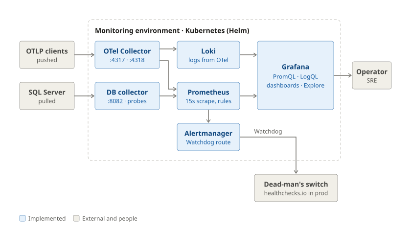
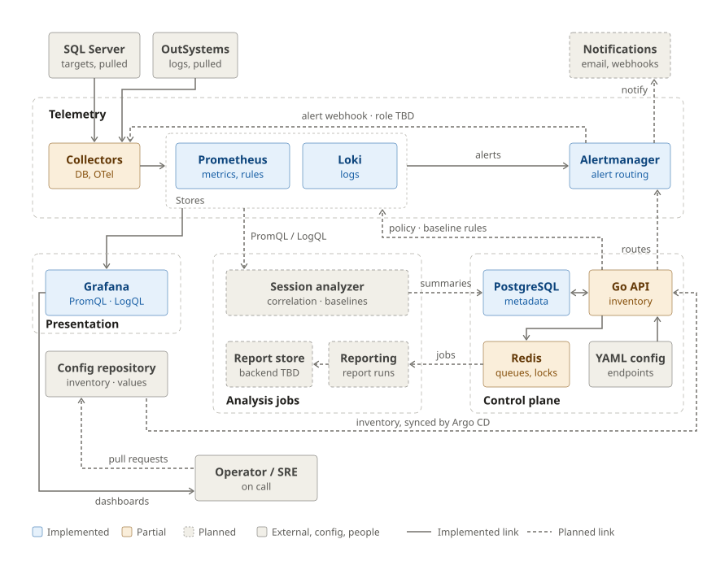

# Heartbeat Architecture Overview

Heartbeat collects telemetry from a separate monitoring environment. SQL Server
hosts run no Heartbeat agents. Metrics, logs and traces belong in Prometheus,
Loki and Tempo; PostgreSQL holds the durable metadata of the control plane,
the API.

## How to read the diagrams

- Arrows follow the direction data moves. Labels say whether it is *pulled*
  (scraped/queried by the receiver) or *pushed* by the sender.
- Colour encodes status only: **blue** implemented, **amber** partial,
  **dashed gray** planned or idle. Solid gray boxes are external systems,
  configuration and people. Dashed outlines group components by environment
  or plane.
- Solid arrows are implemented or configured connections, not proof of a
  successful live deployment. Dashed arrows are planned; an **amber arrow**,
  where present, marks a known gap in otherwise-implemented components.
- The diagrams are SVG files in [`diagrams/`](diagrams/). Edit them together
  with this page when the architecture changes.

## Current runtime

This diagram reflects the checked-in services and the Helm chart
([`infra/helm/heartbeat`](../../infra/helm/heartbeat)), as deployed on kind and
in CI. Production on EKS runs the same chart with production values; it is
not built yet ([roadmap](../product/roadmap.md), phase 5).

The default integration file has no SQL Server targets. Configure a target using
the [database onboarding runbook](../guides/database-targets.md), or use the
[local development sandbox](../guides/local-development.md#sql-server-sandbox), to collect database metrics.
The SQL metric path has no PostgreSQL dependency, Redis queue, or durable
collector-side sample buffer.

OutSystems 11 logs also come in through the DB collector: its `outsystems_logs`
kind reads them from the logging database on SQL Server and pushes them as
OTLP to the OTel Collector, which sends them to Loki
([application observability](application-observability.md)).

Not drawn: self-scrapes (Prometheus, Loki, Alertmanager); the OTLP the DB
collector and the API push to the OTel Collector (OutSystems logs, audit
records, their own logs and spans); Tempo, which stores the traces; and the
API with PostgreSQL and Valkey. They are in the table below, which is current.

### Component details

| Component | Endpoints | Notes |
| --- | --- | --- |
| DB collector | `:8082` — `/metrics`, `/healthz`, `/readyz`, `/admin/config`, `POST /admin/config/reload` | Reload also on SIGHUP, and on file change when `HEARTBEAT_CONFIG_WATCH_INTERVAL` is set. Credentials resolved from `HEARTBEAT_CREDENTIAL_*`. |
| API | `:8081` — `/metrics`, `/healthz`, `/readyz`, `/api/v1/…` | The control plane ([ADR 0013](decisions/0013-api-design-and-subsystem-boundaries.md)): login and roles, the inventory, telemetry sources, database targets, probe definitions and assignments (rendered to the chart's `managedCollectors`), deep links into Grafana and audit records. It applies the environment's inventory file when the chart mounts one ([ADR 0021](decisions/0021-inventory-as-code-and-no-web-ui.md)). An init container applies `db/migrations` first, and readiness waits for PostgreSQL at the newest of them and for Redis. Its own logs and spans go to the OTel Collector like the collector's. |
| PostgreSQL / Valkey | `:5432` / `:6379` | The API's metadata store and Redis, as small one-replica StatefulSets for kind and CI; production uses Amazon RDS and ElastiCache ([ADR 0015](decisions/0015-postgresql-and-redis-delivery.md)). |
| OTel Collector | OTLP `:4317` gRPC / `:4318` HTTP; Heartbeat's own logs `:4319` HTTP; Prometheus export `:8889`; health `:13133` | Exports logs to Loki's OTLP endpoint and traces to Tempo. Loki indexes only `service.name`, `service.namespace`, `deployment.environment.name` and `outsystems.log_type` as labels; every other attribute, including user, session and request IDs and client IP, is kept as structured metadata. |
| Prometheus | `:9090` | 15s scrape. Rule files `heartbeat.rules.yml` and `generated/` (currently empty). Sends alerts to Alertmanager. |
| Alertmanager | `:9093` | `default` and `deadmans-switch` receivers with no integrations on kind ([ADR 0009](decisions/0009-remove-the-otel-gateway.md)); the always-firing `Watchdog` alert routes to `deadmans-switch`. The production example adds chat receivers and healthchecks.io. |
| Loki / Tempo / Grafana | `:3100` / `:3200` / `:3000` | Tempo keeps traces for 7 days ([ADR 0018](decisions/0018-heartbeats-own-telemetry.md)). Grafana is provisioned with Prometheus (default), Loki and Tempo data sources and the Heartbeat dashboards. |

Inside the cluster each component accepts connections only from the components
that use it, on the ports above, through ingress NetworkPolicies. Grafana is
open to whatever serves its UI and relies on its login. Kubelet probes and
`kubectl port-forward` are not filtered. Loki holds raw user and session IDs
and client IPs, so this is part of their protection
([ADR 0012](decisions/0012-personal-data-in-telemetry.md)). Which component
reaches which, and the values that set it, are in the
[chart guide](../guides/kubernetes-local.md#network-access).

Integration tests use disposable PostgreSQL and Valkey containers of the same
versions ([ADR 0015](decisions/0015-postgresql-and-redis-delivery.md)).

## Target platform

The target adds operator workflows around the telemetry path. The implemented
collectors are collapsed into one node and Prometheus and Loki into one
*Stores* group; see [Current runtime](#current-runtime) for their internals.
The dashed groups are the planes described in [Core systems](#core-systems).
An existing store does not imply that its planned consumers are implemented.
The control plane is partly built: the API serves the inventory and Redis
holds its login sessions, while job queues wait for the analysis workers
(phase 7). The configuration repository (`heartbeat-deploy`) and Argo CD come
with production delivery (phase 5); until then the chart mounts the
inventory file directly.

Session analysis owns correlation and baselines; reporting owns report
generation. Their queue protocol, scheduling details, artifact backend, and
provisioning interfaces still need to be defined. Baseline metadata lives in
PostgreSQL; live rule evaluation belongs in Prometheus. Audit records
([ADR 0016](decisions/0016-audit-records-through-an-outbox.md)) and optional
DB evidence snapshots are omitted from this overview; the collector's
current evidence sink does not retain them.

## Open questions

- How do alerts become persisted investigation events (phase 7): an
  Alertmanager webhook into the API, or the API reading Alertmanager?
- Who renders the chart's `files/prometheus/rules/generated/` — the API (as
  drawn) or a build step?

## Data ownership and boundaries

| System | Owns | Boundary |
| --- | --- | --- |
| PostgreSQL | Inventory (applied from the inventory file or written through the API), policy intent, investigation summaries, evidence links, baseline versions, report-run metadata | No raw telemetry, raw sessions, audit streams, or report binaries |
| YAML / Kubernetes | Integration endpoints, dashboard URL templates, collector desired runtime state, credential references, each environment's inventory file | Active collector targets/probes come from config, not PostgreSQL; approved probe assignments are rendered into it ([ADR 0014](decisions/0014-probe-assignments-to-runtime-config.md)) |
| Prometheus | Metric time series and executable recording/alert rules | Metrics are scraped from collectors; no SQL metric buffering in Redis/PostgreSQL |
| Loki | Logs and queryable operational evidence | High-cardinality investigation identifiers are kept as structured metadata, never index labels |
| Redis (Valkey) | Transient job delivery, retries, locks, short-lived caches, login sessions | Not the durable source of investigation or report state ([ADR 0013](decisions/0013-api-design-and-subsystem-boundaries.md)) |
| Artifact storage (planned) | Generated report files | PostgreSQL retains the artifact URI only; backend is undecided |

Application-owned workflows derive environment from `applications.environment_id`.
Remote SQL probes must respect query budgets and least-privilege access. Collector
recovery, replica ownership, fencing, and downstream buffering remain
[planned reliability work](database-observability.md#collector-recovery-and-high-availability-planned).
Oracle is a future target; Grafana Alloy is a later comparison, not a selected
replacement in the current architecture.

## Implementation references

The current runtime diagram was checked against the chart and a kind
deployment on 2026-10-03 (`make kind-e2e`); what the chart added since and the
diagram does not draw is listed under it.

- [Chart values](../../infra/helm/heartbeat/values.yaml): Prometheus scrape jobs
  and alerting, OTel pipelines, Alertmanager routes, Grafana data sources;
  [Heartbeat templates](../../infra/helm/heartbeat/templates/).
- [DB collector wiring](../../services/db-collector/internal/app/app.go),
  and [probe runner and evidence sink](../../services/db-collector/internal/collectors/runner.go).
- [API wiring](../../apps/api/internal/app/app.go) and its contract,
  [`openapi.yaml`](../../apps/api/openapi.yaml).
- Integration configuration (the chart's `integrations` values),
  [operator workflows](workflows.md), [data model](data-model.md), and
  [implementation checklist](../../TODO.md).

## Core systems

Heartbeat is organized into four planes, the same four groups as the
[target platform](#target-platform) diagram.

| Plane | Components | Status | Details |
| --- | --- | --- | --- |
| Telemetry | Collection (DB collector, OpenTelemetry Collector), storage and evaluation (Prometheus, Loki, Tempo), alert routing (Alertmanager) | Implemented, including OutSystems derived metrics and SLO alerts | [Current runtime](#current-runtime), [database observability](database-observability.md), [metrics and endpoints](../reference/metrics-and-endpoints.md) |
| Analysis jobs | Session analyzer (correlation, adaptive baselines), reporting, report storage | Planned | [Operator workflows](workflows.md) |
| Control plane | Go API, PostgreSQL (durable metadata), Redis (queues, locks, retries), YAML/Kubernetes config | Implemented: schema, config manager, and the API with login and roles, inventory, sources, targets, probe assignments, deep links and audit, deployed with PostgreSQL and Valkey; the API applies the inventory file. Planned: job queues and the investigation, alerting and reporting APIs (phase 7) | [Data model](data-model.md), [configuration](../reference/configuration.md), [decisions](decisions/README.md) |
| Presentation | Grafana dashboards, and the API's deep links into them; no Web UI: the inventory is code ([ADR 0021](decisions/0021-inventory-as-code-and-no-web-ui.md)) | Grafana and deep links implemented; inventory dashboard planned | [Operator workflows](workflows.md) |

## Architectural guardrails

Rules every subsystem follows. The reasoning is recorded in the
[architecture decisions](decisions/README.md).

- Services emit only OTLP (to the OpenTelemetry Collector) and Prometheus
  exposition (`/metrics`), never a platform's own write API. Only the Collector
  config and the chart name the observability platform; dashboards, rules and
  link templates are per-platform content
  ([ADR 0011](decisions/0011-platform-agnostic-telemetry-boundary.md)).

- The API never queries SQL Server directly; all database-specific collection
  stays in `db-collector`.
- Redis is never the system of record. Durable job and request state lives in
  PostgreSQL (`investigation_jobs`, `report_runs`); workers must be idempotent.
- Loki labels stay low-cardinality. User, session, request and IP identifiers go
  in structured metadata or the log body, never in labels.
- Adaptive alert math is not computed in Grafana dashboards. Services compute and
  version baselines; executable rules are rendered to Prometheus.
- Custom parsers never bypass the shared telemetry contract in
  `packages/telemetry-contracts`.
- There is one ownership path per record: application-owned rows derive their
  environment through `applications.environment_id`.
- Collector desired state comes from YAML/Kubernetes, not PostgreSQL. Runtime
  state is exposed through metrics, health endpoints and logs.
- Stock OpenTelemetry Collector configuration first: push sources arrive over
  OTLP and are mapped with OTTL. Custom ingest code needs its own decision
  ([ADR 0009](decisions/0009-remove-the-otel-gateway.md)).

The repository layout is described in the [README](../../README.md#repository-layout).
